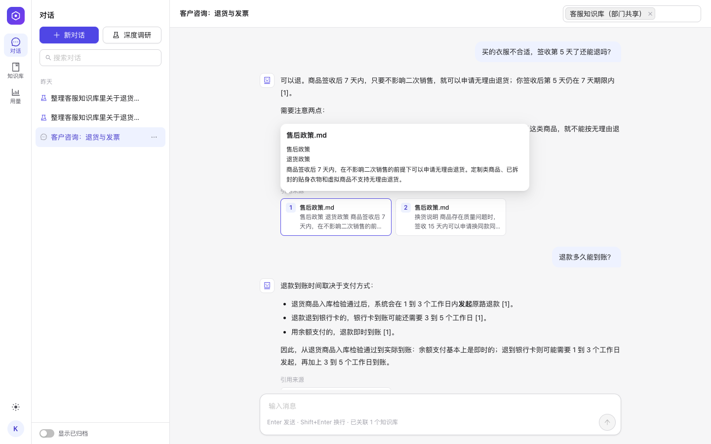
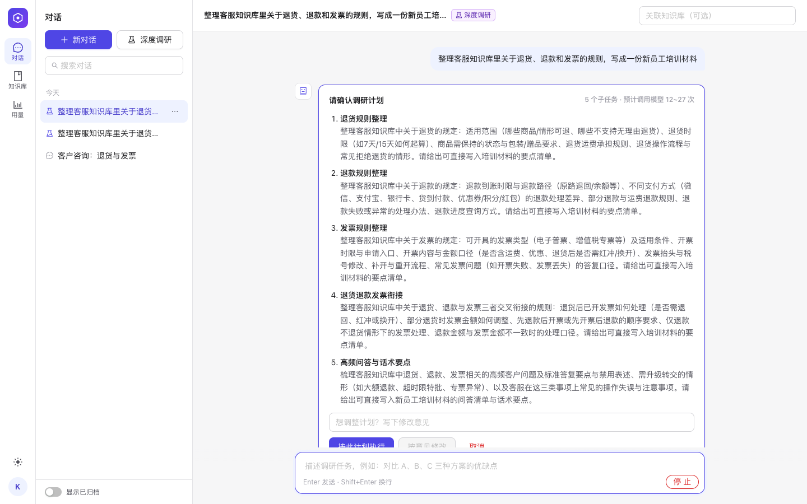
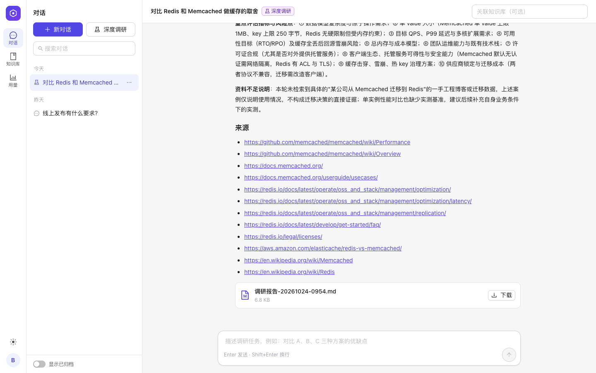
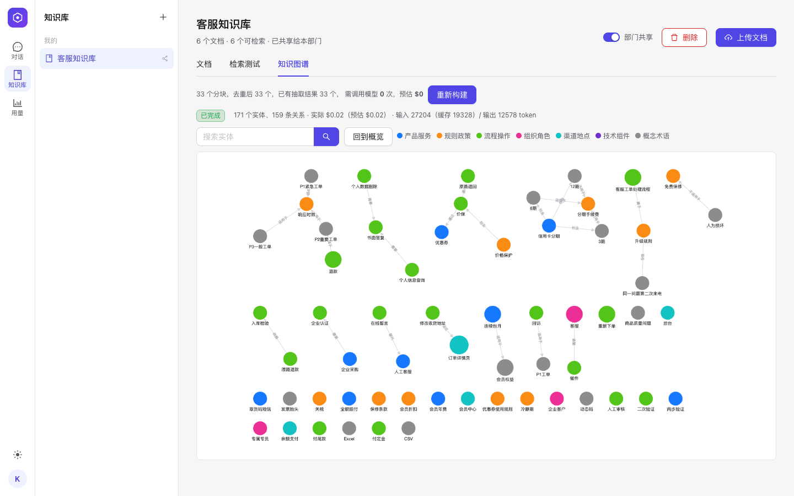
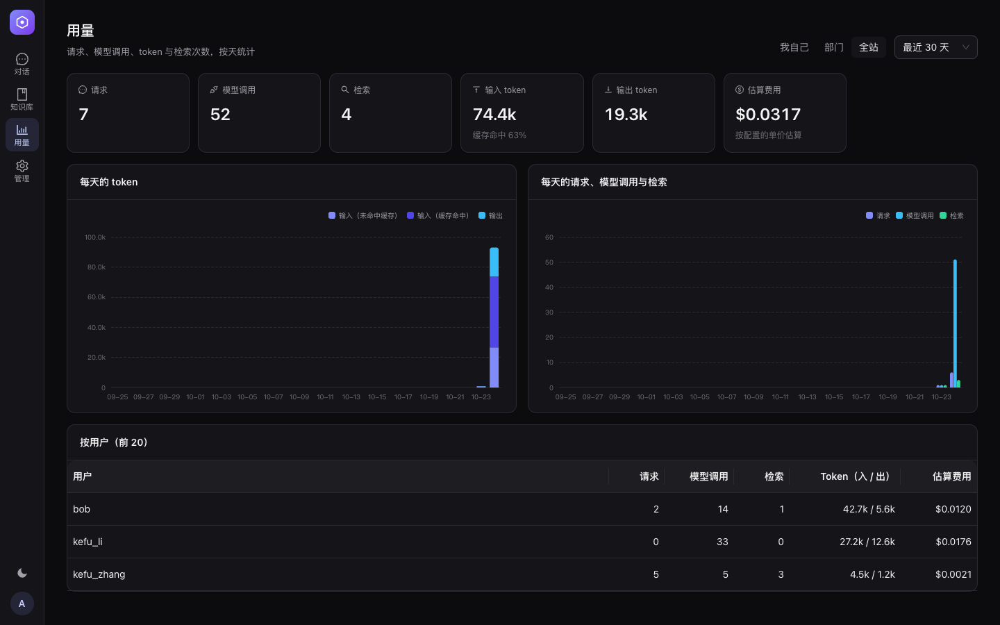
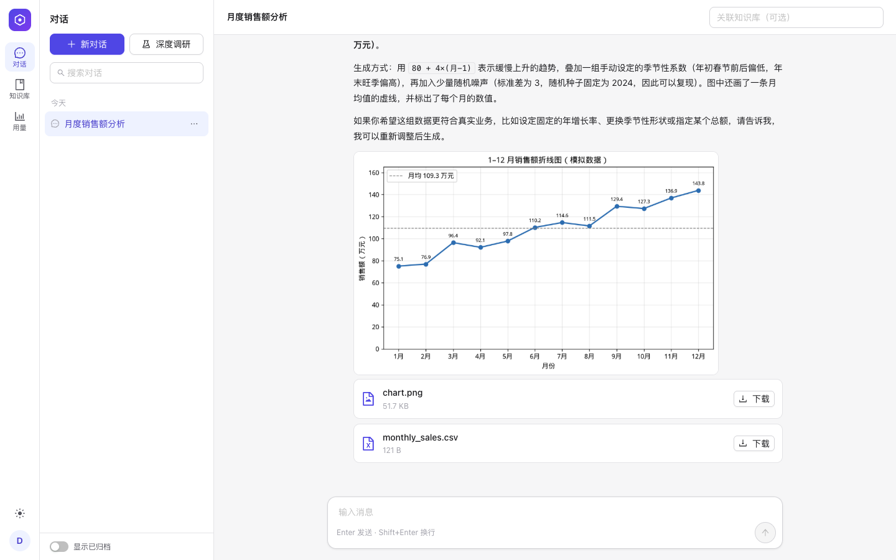
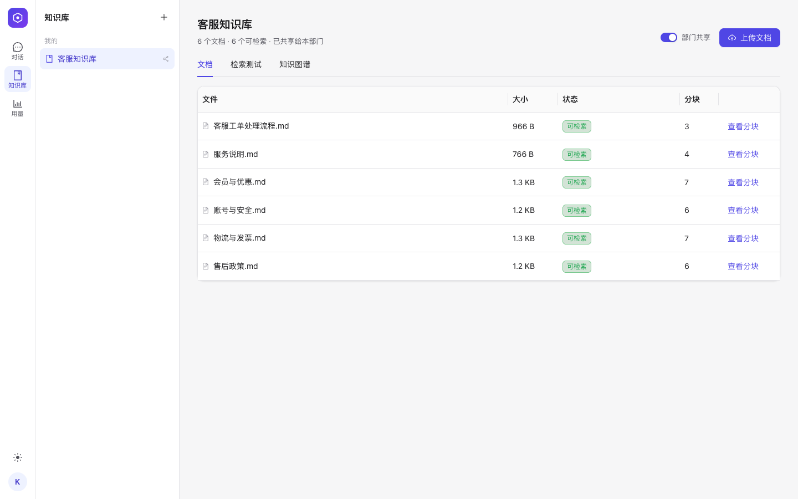

# AgentNexus

## 项目定位

AgentNexus 是一个面向团队私有部署的知识库与 Agent 平台：上传文档建立知识库，和 Agent 对话时回答逐句标注引用；从文档抽取知识图谱并溯源；发起“深度调研”，确认计划后并行调研、生成可下载的报告；Agent 可以在隔离沙盒里执行代码、经出口代理抓取网页。多用户按部门隔离（应用层检查 + PostgreSQL 行级安全），用量有看板。安全设计与已知局限见 [SECURITY.md](SECURITY.md)。演示场景是**客服知识库**（`backend/scripts/seed_demo.py` 一键生成）。

每一项技术选型都先做实验再决定，推导过程见 [docs/decisions/](docs/decisions/) 与 [docs/interview-prep.md](docs/interview-prep.md)；基础设施规模按个人项目的体量做了取舍，见 [docs/tech-tradeoffs.md](docs/tech-tradeoffs.md)。



| 深度调研：先确认计划 | 调研报告与下载 |
|---|---|
|  |  |
| **知识图谱：从文档抽取实体与关系** | **用量看板（深色模式）** |
|  |  |
| **数据分析：沙盒里画图，图表和数据作为附件交付** | **知识库：上传、处理状态、删除** |
|  |  |

## 技术栈

| 层 | 选型 |
|---|---|
| 前端 | Vue 3 + Vite + Ant Design Vue |
| 后端 API | FastAPI |
| Agent 编排 | LangGraph（checkpoint 续做、interrupt 审批、Send 并行子 Agent）+ LangChain 模型适配 |
| 检索 | Qdrant：稠密向量 + 关键词稀疏向量，服务端 RRF 融合，再重排 |
| 关系型存储 | PostgreSQL（事实来源；行级安全做第二道隔离）|
| 任务队列 | PostgreSQL 租约队列（SKIP LOCKED + 心跳 + fencing token，实验后替代 ARQ）|
| 实时事件 | Redis Streams + SSE（断线续传）|
| 登录 | 服务端会话 + HttpOnly Cookie，argon2id；Redis 计数的失败次数限制 |
| 对象存储 | 本地数据卷（`BlobStore` 接口，可换 MinIO / S3） |
| 知识图谱 | Neo4j（派生存储，PostgreSQL 为事实来源）+ cytoscape.js |
| 文档解析 | pypdf / python-docx（在子进程里解析，有超时和内存上限） |
| Embedding / 重排 | bge-small-zh-v1.5、bge-reranker-v2-m3（fastembed / ONNX，本地运行） |
| 模型 | DeepSeek（Anthropic 兼容接口）；默认假模型，无需密钥即可跑通 |
| 工具沙盒 | 独立 sandbox 服务（唯一持有 Docker socket）+ 加固的一次性容器；MCP 网关 + Squid 出口代理 |
| 部署 | Docker Compose（12 个服务，一键启动）；GitHub Actions CI（含 pip-audit / npm audit 依赖扫描） |

## 快速开始

```bash
cp .env.template .env              # 修改各项密码（POSTGRES / NEO4J / SANDBOX_TOKEN / DB_API / DB_WORKER）；默认 LLM_PROVIDER=fake，无需模型密钥
docker compose up -d --build
docker compose exec -e PW='<管理员密码>' api python -m agentnexus.cli create-user --name admin --role admin --password-env PW
```

打开 http://localhost:8080 ：用 admin 登录 → 在“管理”里建部门和用户 → 新对话 → 发消息，回复会逐字出现。

演示数据（客服部 / 研发部、3 个账号、部门共享的客服知识库；不调用模型）：

```bash
ADMIN_PASSWORD='<管理员密码>' DEMO_PASSWORD='<演示账号密码>' python backend/scripts/seed_demo.py   # 需要 httpx；加 --graph --ask 会构建图谱并预先问几个问题（真实模型下花费约 $0.02）
```

接入真实模型：在 `.env` 里设置 `LLM_PROVIDER` / `LLM_MODEL` / `LLM_API_KEY`（说明见 `.env.template`），然后 `docker compose up -d api worker`（模型调用在 worker 里执行）。
README 截图由 `scripts/screenshots.py` 生成（Playwright + 本机 Chrome）。

## 文档索引

- [ARCHITECTURE.md](ARCHITECTURE.md) — 架构：进程拓扑、代码地图、核心链路、架构不变量
- [SECURITY.md](SECURITY.md) — 安全：威胁模型、每道防线在哪里（登录限流、RLS、沙盒、出口代理、子进程解析、依赖扫描）、已知局限、报告方式
- [ROADMAP.md](ROADMAP.md) — 分阶段学习与开发路线图（3-4 个月）
- [docs/tech-tradeoffs.md](docs/tech-tradeoffs.md) — 基础设施与能力深度的取舍及理由
- `docs/decisions/` — 关键架构决策记录（每次重大取舍写一条，含背景/决定/后果/验证）
- [docs/guides/message-lifecycle.md](docs/guides/message-lifecycle.md) — 学习导读：一条消息从发送到流式显示的完整旅程（代码位置、设计理由、故障表现、自测题）
- [docs/guides/worker-leases.md](docs/guides/worker-leases.md) — 学习导读：独立 worker 与租约（认领、心跳、fencing、续做、跨进程取消、崩溃接管实测）
- [docs/guides/knowledge-graph.md](docs/guides/knowledge-graph.md) — 学习导读：知识图谱的抽取、合并、存储分工、失败与恢复、自测题
- [docs/guides/frontend-design.md](docs/guides/frontend-design.md) — 学习导读：前端设计系统（token 如何驱动组件库、CSS 变量与图表，Agent 工作的可视化，改版踩坑）
- [docs/guides/auth-tenancy.md](docs/guides/auth-tenancy.md) — 学习导读：登录、部门隔离与用量（会话 vs JWT、CSRF、RLS 的价值与陷阱、用量采集、自测题）
- [docs/guides/multi-agent-research.md](docs/guides/multi-agent-research.md) — 学习导读：深度调研（Send 并行与崩溃续做、interrupt 审批的陷阱、等待审批放弃租约、报告产物、自测题）
- [docs/guides/tools-sandbox.md](docs/guides/tools-sandbox.md) — 学习导读：工具、沙盒与 MCP（威胁模型、socket 风险、SSRF 与出口代理、Skills、自测题）
- [docs/guides/rag-pipeline.md](docs/guides/rag-pipeline.md) — 学习导读：一份文档从上传到成为回答里的引用（入库、检索、重排、预检索与工具、三层评测、自测题）
- [docs/PROGRESS.md](docs/PROGRESS.md) — 进度与架构总图：当前位置、主链路、数据模型、分模块任务清单（勾选）
- [docs/dev-log.md](docs/dev-log.md) — 开发日志：每一步的设计思路、取舍与踩坑记录
- `docs/interview-prep.md` — 面试拷打准备文档，解释每个模块的设计原因和业务逻辑
- `docs/learning-notes/` — 按主题记录的学习笔记（含本地私有的问答记录，未纳入版本管理）

## 目录结构

完整的代码地图、进程拓扑、核心链路和架构不变量见 [ARCHITECTURE.md](ARCHITECTURE.md)。

```
AgentNexus/
├── backend/
│   ├── server/                  # FastAPI 入口 + 路由层（薄）
│   ├── package/agentnexus/      # 业务逻辑（厚）：agents、runtime、services、knowledge、security、sandbox、mcp_gateway……
│   ├── migrations/              # Alembic 迁移（只往前加）
│   ├── skills/                  # Agent 技能文件
│   ├── tests/                   # 集成测试（真实 PostgreSQL / Redis / Neo4j / Docker）
│   └── eval/                    # 选型实验与评测脚本
├── web/                         # Vue 3 + Vite + Ant Design Vue 前端
├── docker/                      # 各镜像 Dockerfile、Nginx、Squid 配置
├── docs/                        # 决策记录、走读、开发日志、面试准备
├── .github/workflows/ci.yml     # CI：lint + 测试 + 构建
└── docker-compose.yml           # 一键启动全部服务
```

## 当前进度

- [x] 阶段 0：环境与技术选型
- [x] 阶段 1：核心骨架与 Agent 编排引擎（流式聊天、取消 / 重试、请求追踪、对话管理；走读见 docs/guides/message-lifecycle.md）
- [x] 阶段 2：RAG 知识库（上传 → 后台入库 → 本地向量化 + Qdrant → 召回 + 重排 → 预检索与检索工具 → 带引用的回答；三层评测；走读见 docs/guides/rag-pipeline.md）
- [x] 阶段 3：知识图谱（LLM 结构化抽取 + 缓存与费用预估 → 合并 → PostgreSQL 事实来源 + Neo4j 派生存储 → 图谱浏览与溯源；走读见 docs/guides/knowledge-graph.md）
- [x] 阶段 4：多智能体、工具与扩展生态（独立 worker + PostgreSQL 租约队列，走读见 docs/guides/worker-leases.md；沙盒执行代码、MCP 网关 + 出口代理、Skills，走读见 docs/guides/tools-sandbox.md；深度调研：计划审批 + 并行子 Agent + 可下载报告，崩溃后只重做未完成的子任务，走读见 docs/guides/multi-agent-research.md）
- [x] 阶段 5：多租户权限与 Dashboard（会话登录、部门共享、应用层 + PostgreSQL RLS 双重隔离、用量看板，走读见 docs/guides/auth-tenancy.md）
- [ ] 阶段 6：打磨、部署与简历包装（已完成：6.1 前端设计系统与改版，走读见 docs/guides/frontend-design.md；6.2 从零部署实测、ruff、CI；6.3 演示数据与截图；6.4 安全收尾，见 [SECURITY.md](SECURITY.md)。剩余：演示视频）
- [x] 补全 7.1：删除知识库与文档（数据库事务 + 清理任务发件箱，派生存储故障时删除照样成功，见 docs/decisions/0026）
- [x] 补全 7.2：Agent 把沙盒里画的图、算的表作为附件交给用户（见 docs/decisions/0027）
- [x] 补全 7.3：删除对话（文件、工作空间、checkpoint 一并清理，用量统计保留，见 docs/decisions/0028）
- [x] 补全 7.5：混合检索（稠密向量 + 关键词，大语料下精确词查询的候选召回 0.70 → 1.00，见 docs/decisions/0029）
- [x] 补全 7.6：追问的预检索（两路检索交替合并，追问命中 0.87 → 1.00、换话题不被带偏，见 docs/decisions/0030）
- [x] 补全 7.7 ~ 7.8：回答质量评测（模型裁判，先用篡改的回答校准）；运行状态（管理页面 + Prometheus `/metrics`，见 docs/decisions/0031）
- [x] 补全 7.9：每个用户最近 24 小时的模型费用上限（防失控，见 docs/decisions/0032）

详见 [ROADMAP.md](ROADMAP.md)。
