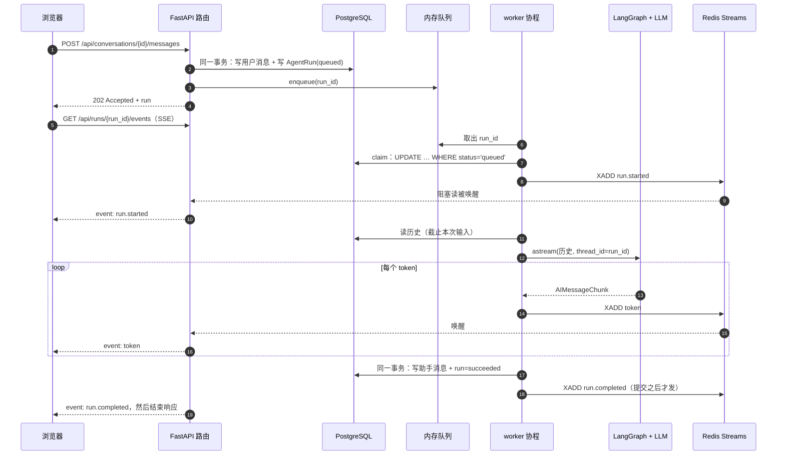

# 一条消息的完整旅程

> 学习导读：跟着一条用户消息，从发出请求到浏览器里逐字显示，走一遍 AgentNexus 目前的核心链路。
> 每一步都写了**发生了什么、代码在哪、为什么这样设计、出了故障会怎样**。读完应该能对着代码讲清楚整条链路。
> 对应阶段：ROADMAP 阶段 1（核心骨架）。相关决策：[0009](../decisions/0009-cancel-retry-error-codes.md)（取消/重试/错误码）、[0008](../decisions/0008-frontend-integration.md)（前端）、[0004](../decisions/0004-data-layer-sqlalchemy-alembic.md)、[0005](../decisions/0005-in-process-dispatcher-first.md)、[0006](../decisions/0006-history-source-of-truth.md)、[0007](../decisions/0007-streaming-events.md)。

---

## 0. 先建立整体印象

一条消息会经过三个“世界”，每个世界只负责一件事：

| 世界 | 存什么 | 地位 |
|---|---|---|
| **PostgreSQL** | 用户、对话、消息、AgentRun（执行记录）、LangGraph checkpoint | **唯一事实来源**：说了什么、执行到哪、结果是什么，以这里为准 |
| **进程内存** | 派发队列（`asyncio.Queue`） | 只是“加速触发”，丢了不影响正确性 |
| **Redis Streams** | 每个 run 的事件流（`run:{run_id}:events`） | 只是“视图”，给浏览器实时看进度，丢了只影响实时性 |

整条链路的时序：



---

## 1. 发消息：落库就是承诺

**入口**：`POST /api/conversations/{conversation_id}/messages` → [`send_message`](../../backend/server/routers/conversations.py)

**发生了什么**

1. 依赖 [`current_user_id`](../../backend/server/deps.py) 从 `X-User-Id` 头取出用户（鉴权占位，阶段 5 换成 token）。
2. 调 [`RunService.submit`](../../backend/package/agentnexus/services/runs.py)：在**同一个数据库事务**里
   - 校验对话属于这个用户（不属于和不存在一样返回 404，不泄露 id 是否存在）；
   - 写入用户消息（`messages` 表）；
   - 写入一条 `status='queued'` 的 AgentRun（`agent_runs` 表）。
3. 事务提交后，`dispatcher.enqueue(run.id)` 把 run_id 放进内存队列。
4. 返回 **202 Accepted** 和这个 run（客户端拿 run_id 去订阅进度）。

**为什么这样设计**

- **“消息 + queued run” 必须同事务**：两者要么都在、要么都不在。只有消息没有 run → 用户发了话没人处理；只有 run 没有消息 → 执行时找不到输入。
- **事务提交 ⇒ 一定会被执行**：这是整条链路最重要的承诺。之后哪怕 enqueue 没发生（进程正好崩溃），派发器的**周期扫描**也会把 `queued` 的 run 补投（见第 2 步）。这是“事务性发件箱”模式的简化版。
- **投递放在事务提交之后**：如果先投递，worker 可能在事务提交前就去读，读不到数据。
- **202 而不是 200/201**：语义是“已受理、尚未处理完”。

**数据库层的不变量**（[models.py](../../backend/package/agentnexus/storage/postgres/models.py)）

- 部分唯一索引 `uq_agent_runs_one_active_per_conversation`：同一对话同一时刻最多一个 `queued/running` 的 run。第二次发消息会触发唯一约束 → 服务层转成 `RunConflict` → 409。为什么不在应用层“先查再插”？因为两个请求并发时都会查到“没有活跃 run”，然后都插入成功；唯一索引由数据库串行化保证。
- 消息按自增 `seq` 排序，而不是 `created_at`：同一事务内 `now()` 返回的是事务开始时间，多条消息的时间相同。

**自己观察**

```bash
# 发消息（先建用户和对话，见 README 或 docs/dev-log.md 里的 curl 示例）
curl -s -X POST localhost:8000/api/conversations/<cid>/messages \
  -H "X-User-Id: <uid>" -H 'content-type: application/json' -d '{"content":"你好"}'
# 看数据库里刚写入的两行
docker compose exec postgres psql -U agentnexus -c "select id, status from agent_runs order by created_at desc limit 1"
```

---

## 2. 派发：队列只是信使，抢占靠数据库

**代码**：[`RunDispatcher`](../../backend/package/agentnexus/runtime/dispatcher.py)（在 api 进程里运行，[`lifespan`](../../backend/server/main.py) 启动时 `start()`）

**发生了什么**

- `start()` 时：
  1. **启动恢复**：把上次进程遗留的 `running` 全部置为 `failed("interrupted: worker restarted")`，并为它们补发 `run.failed` 事件；
  2. 扫描一次 `queued` 补投；
  3. 启动 N 个 worker 协程（`WORKER_CONCURRENCY`，默认 4）和一个周期扫描协程（默认每 5 秒）。
- 每个 worker 循环：从队列取 run_id → [`_process`](../../backend/package/agentnexus/runtime/dispatcher.py)。
- `_process` 第一步是 **`claim`**：`UPDATE agent_runs SET status='running' WHERE id=? AND status='queued'`，看 `rowcount` 是否为 1。抢不到就直接返回。

**为什么这样设计**

- **为什么还要 claim**：同一个 run 可能被投递两次（提交时投一次，扫描又补投一次）。执行前统一原子抢占，只有一个人能把 `queued` 改成 `running`。内存里的 `_pending` 集合只是减少重复排队的优化——我做过变异检查：删掉它测试依然全过，证明真正的保证来自 claim。
- **为什么先用进程内队列而不是直接上 ARQ**：ARQ 解决的是“多 worker 之间的分发与存活判定”，那是阶段 4 的问题。先把单机语义测透，换传输层时只改派发器。
- **启动恢复的边界**：它只在“整个系统只有一个这样的进程”时安全——如果有两个 api 实例，B 启动时会把 A 正在执行的 run 也置为失败。这就是阶段 4 必须引入 **lease（租约）+ heartbeat** 的原因：只有租约过期的 run 才允许被接管。

**每种失败都要把 run 收尾到终态**

| 情况 | 处理 | 不处理的后果 |
|---|---|---|
| Agent 抛异常 | `fail(error)` | run 永远 `running`，唯一索引把这个对话永久锁死 |
| 超时（`RUN_TIMEOUT_SECONDS`，默认 300） | `fail("timeout …")` | 同上 |
| 优雅关停 | `shield(fail("interrupted: shutdown"))`，`shield` 保证收尾写库不被再次取消打断 | 同上 |
| 进程被强杀 | 下次启动的“启动恢复” | 同上 |

---

## 3. 执行：历史来自数据库，checkpoint 按 run 划分

**代码**：[`RunService.load_context`](../../backend/package/agentnexus/services/runs.py) → [`ChatbotAgent.run`](../../backend/package/agentnexus/agents/buildin/chatbot/agent.py) → [`build_graph`](../../backend/package/agentnexus/agents/buildin/chatbot/graph.py)

**发生了什么**

1. `load_context` 从 `messages` 表取出**截止到本次输入消息（含）**的历史，组装成 `RunContext`（与框架无关的 `ChatMessage` 列表）。
2. 派发器把事件出口 `events`（绑定到这个 run 的发布器）塞进 `RunContext`。
3. `ChatbotAgent.run`：
   - 用 [`to_langchain`](../../backend/package/agentnexus/agents/messages.py) 把历史转成 LangChain 消息；
   - `graph.astream(..., stream_mode=["messages", "values"])`，`thread_id = run_id`；
   - `"messages"` 流里每来一个 `AIMessageChunk`，取文本（[`message_text`](../../backend/package/agentnexus/agents/messages.py)）后 `ctx.events.emit("token", {"text": ...})`；
   - `"values"` 流的最后一个就是最终状态，从中取最终回复文本返回。
4. 图里只有一个节点：调用前把系统提示词拼在最前面，`model.ainvoke(...)`。

**为什么这样设计**（[决策 0006](../decisions/0006-history-source-of-truth.md)，有对照实验）

- **历史以 `messages` 表为准，不以 checkpoint 为准**：实验证明“表的全量历史 + checkpoint 已有历史”会让消息翻倍；给消息加稳定 id 也只能修好用户消息（助手消息的 id 由图自己生成）。
- **checkpoint 的 thread_id 用 run_id 而不是 conversation_id**：checkpoint 只保存“一次执行的进行中状态”。实验证明同一个 run 的 thread 在失败后可以 `invoke(None)` 从失败节点续跑、已完成的节点不重做——这正是阶段 4“中断审批 / 崩溃接管”需要的能力。
- **系统提示词不写进 state**：checkpoint 不重复存它，改提示词也不用迁移历史状态。
- **节点里用 `ainvoke` 也能拿到逐段 token**：LangGraph 的 `"messages"` 流模式通过回调拿到模型内部的流式输出，节点代码不用改（实验：真实 Gemini 9 个事件分散在约 1 秒内）。
- **最终回复取自最终状态，而不是把 token 拼起来**：状态是图认定的结果，token 只是过程中的视图。
- **Agent 的签名一直是 `run(ctx) -> str`**：流式只是“边执行边 emit”。派发器、回声 Agent、旧测试都不需要改。

**模型从哪来**：[`build_chat_model`](../../backend/package/agentnexus/models/factory.py) 按环境变量 `LLM_PROVIDER` 选：`fake`（默认，确定性回声，支持流式）、`openai`（任意 OpenAI 兼容接口）、`anthropic`（任意 Anthropic 兼容接口）、`google`（Gemini）。当前使用 DeepSeek 的 Anthropic 兼容接口并关闭思考模式（决策 0013）；四个分支中除 `fake` 外都用真实 key 验证过。

---

## 4. 收尾：先提交，再发布

**代码**：`_process` 的 `else` 分支、[`_fail`](../../backend/package/agentnexus/runtime/dispatcher.py)

- 成功：[`RunService.complete`](../../backend/package/agentnexus/services/runs.py) 在**同一事务**里写助手消息 + 把 run 置为 `succeeded`，返回消息 id；**然后**发布 `run.completed {message_id}`。
- 失败：`fail` 提交成功**之后**才发布 `run.failed {error}`。

**为什么必须“先提交、再发布”**：浏览器收到 `run.completed` 后很可能马上去拉历史。如果事件先于提交发出，它会拉到一个“还没有助手回复”的历史。测试 `test_success_events_order_tokens_and_commit_before_completed` 在收到完成事件的那一刻去查库，断言消息已存在；变异检查把顺序颠倒后，这个测试失败。

**run 失败时，已推送的半截 token 怎么办**：不入库。`messages` 表只存最终文本（决策 0006），前端把已显示的内容标成“生成中断”（决策 0007，已确认）。

---

## 5. 事件通道：Redis Streams

**代码**：[`events/redis_stream.py`](../../backend/package/agentnexus/events/redis_stream.py)、事件契约 [`events/types.py`](../../backend/package/agentnexus/events/types.py)

**事件类型**

| 事件 | data | 何时 |
|---|---|---|
| `run.started` | `{}` | claim 成功后 |
| `token` | `{"text": "..."}` | 模型每产出一段文本 |
| `run.completed` | `{"message_id": "..."}` | 助手消息提交后 |
| `run.failed` | `{"error": "..."}` | 失败提交后，或启动恢复时 |

**关键机制**

- **流 ID 就是游标**：`XADD` 返回形如 `1792498820935-0` 的单调递增 ID，直接作为 SSE 的 `id:`。客户端断线后带 `Last-Event-ID` 重连，服务端用 `XREAD` 从这个 ID 之后继续读。
- **阻塞读 = 推送**：`XREAD BLOCK 5000` 读到末尾会阻塞，有新写入立刻唤醒（实测约 4~6 毫秒的推送延迟）。
- **有界、会过期**：`XADD` 带 `MAXLEN ~ 5000`；终态事件写入时同一个 `MULTI/EXEC` 里设置 `EXPIRE`（默认 1 小时）。
- **发不出去不抛错**：发布失败只记日志，run 照常完成。事件只是视图。
- **两个 Redis 客户端**：发布用一个小连接池，SSE 阻塞读用另一个大连接池（默认 200）。原因：每个 SSE 客户端占一个阻塞连接，如果共用连接池，订阅者一多就会把连接占满，执行方的事件反而发不出去。
- **阻塞读专用客户端的套接字超时必须大于阻塞时长**：见第 7 节的 bug 故事。

**为什么选 Redis Streams**（决策 0007）：进程内队列在阶段 4 拆出独立 worker 后无法跨进程，重启也会丢缓冲；逐 token 写 Postgres 是几百行写入，对用完即弃的数据不划算。Streams 的“单调 ID + 从某 ID 之后读 + 阻塞读”正好对应“推送 + 断线续传 + 晚加入回放”。

**自己观察**

```bash
docker compose exec redis redis-cli XRANGE run:<run_id>:events - +
docker compose exec redis redis-cli TTL run:<run_id>:events
```

---

## 6. SSE：数据库决定流什么时候结束

**入口**：`GET /api/runs/{run_id}/events` → [`run_events`](../../backend/server/routers/events.py) → [`RunEventStreamer.stream`](../../backend/package/agentnexus/services/run_events.py)

**发生了什么**

1. 依赖 [`owned_run`](../../backend/server/deps.py) 做归属校验。**放在依赖里**是因为依赖在响应开始之前执行：不是自己的 run 会直接返回 404，而不是先发出 200 响应头、再在流里报错（变异检查验证过）。
2. 路由用 FastAPI 内置的 `EventSourceResponse`：函数 `yield ServerSentEvent(...)`，框架负责编码；空闲 15 秒自动发 `: ping` 保活；自动加 `Cache-Control: no-cache` 和 `X-Accel-Buffering: no`（防止 Nginx 缓冲）。
3. `stream()` 的循环：
   - 从游标（首次连接是 `0-0`，即从头回放；重连是 `Last-Event-ID`）之后阻塞读；
   - 读到事件就发出去，遇到终态事件就结束；
   - **空闲（这一轮没读到）就查数据库**：如果 run 已经是终态，先再非阻塞读一次（终态事件可能恰好刚写入），还没有就按数据库**合成**一个终态事件（带 `"synthesized": true`、没有 id）然后结束。
4. 客户端断开：框架取消驱动生成器的任务，正在等待的 `XREAD` 被取消，连接释放（测试用 Redis 的 `CLIENT LIST` 观察到“断开后不再有为它阻塞的连接”）。

**为什么“数据库决定何时结束”**：事件可能丢——流过期、Redis 抖动、进程在“提交”和“发布”之间崩溃。如果只靠事件，客户端会永远等下去。有了查库兜底，事件丢失只会让实时性变差，不会让客户端卡死。

**各种异常情况的表现**

| 情况 | SSE 的表现 | 对应测试 |
|---|---|---|
| 正常 | started → token… → completed，然后结束 | `test_sse_wire_format_and_full_flow` |
| run 早已结束，流还在 | 立即全量回放并结束，不等待轮询周期 | `test_late_joiner_replays_everything_after_run_finished` |
| run 早已结束，流已过期 | 立即合成终态事件并结束 | `test_expired_stream_is_synthesized_from_db_immediately` |
| 终态事件丢了 | 下一次空闲查库时合成终态 | `test_lost_terminal_event_is_synthesized_while_waiting` |
| Redis 连不上 | 退化为定期查库，run 结束时仍能收尾 | `test_streamer_falls_back_to_db_polling_when_redis_is_down` |
| 套接字读超时 | 按“空闲”处理，立刻查库再读，不损失实时性 | `test_socket_timeout_on_read_is_treated_as_idle_not_as_outage` |
| 断线重连 | 带 `Last-Event-ID`，从下一个事件继续 | `test_sse_resume_with_last_event_id_header` |
| 客户端中途断开 | 服务端释放阻塞的 Redis 连接 | `test_client_disconnect_releases_blocked_redis_reader` |
| 不是自己的 run | 直接 404，不开始流 | `test_sse_ownership_is_checked_before_streaming` |

**前端注意**：浏览器原生 `EventSource` 不能带自定义请求头，而我们用 `X-User-Id` 头鉴权，所以前端要用基于 `fetch` 的流式读取。不把用户标识放 URL 查询串，因为 URL 会进日志和浏览器历史。

**自己观察**

```bash
curl -N localhost:8000/api/runs/<run_id>/events -H "X-User-Id: <uid>"
# 断线续传：带上收到的某个事件 id
curl -N localhost:8000/api/runs/<run_id>/events -H "X-User-Id: <uid>" -H "Last-Event-ID: <某个 id>"
```

### 6.1 前端怎么消费事件流（`web/`，决策 0008）

**代码**：[`web/src/api/sse.ts`](../../web/src/api/sse.ts)、[`web/src/composables/pendingReply.ts`](../../web/src/composables/pendingReply.ts)、[`web/src/composables/useChat.ts`](../../web/src/composables/useChat.ts)

1. 点“发送” → `POST .../messages` 拿到 202 和 run → 立刻重新拉一次消息列表（用户消息已落库，以数据库为准）。
2. 调 `streamRunEvents(run.id)`：用 `fetch` 请求 `/api/runs/{id}/events`，带 `X-User-Id` 头；把响应体按字节交给 `SseParser`。
3. `SseParser` 按 SSE 规范切行、拼字段、在空行处派发事件。它必须正确处理：数据块在任意位置被切断、`\r\n` 跨块、中文字符的字节被切开、`: ping` 注释行。
4. 每个事件交给状态机 `applyRunEvent`：`waiting`（显示“等待模型开始输出… N 秒”）→ 收到 token 变 `streaming`（逐段追加、显示光标）→ `completed`（重新拉消息列表，用库里的正式回复替换临时回复）或 `failed`（保留半截文本，标成“生成中断”并显示原因）。
5. 断线：网络错误或服务端在终态前关闭连接时自动重连，带 `Last-Event-ID`；401/404 不重试。
6. **刷新页面**：加载对话时调用 `GET /api/conversations/{id}/active-run`，发现活跃 run 就重新订阅；因为事件流从头回放，已经生成的部分立刻补齐，然后继续实时增长。“等待首字”的计时从服务端的 run 创建时间算起。
7. 渲染：Markdown 渲染禁用原始 HTML，模型输出里的 `<script>` 只会显示成文本。

**部署时**：浏览器访问 Nginx（`http://localhost:8080`），Nginx 提供打包好的页面，并把 `/api` 转发给 api 容器；对 SSE 关闭缓冲。

### 6.2 停止、失败与重试（决策 0009）

- **停止**：生成中“发送”变成“停止”，点击后 `POST /api/runs/{id}/cancel`。排队中的 run 直接在库里改为 `cancelled`（200）；执行中的 run 由派发器取消执行 Agent 的任务（202），随后事件流里出现 `run.cancelled`，界面显示“已停止生成”。
- **失败原因**：事件和接口里只有错误码，前端翻译成“模型服务暂时不可用”之类的文案；原始报错只在数据库 `agent_runs.error` 和服务端日志里。
- **刷新后仍可见**：加载对话时一起取回 `GET /api/conversations/{id}/runs`，每条用户消息看它最新的 run，失败或已停止就在下方标注。
- **重试**：最后一条消息的标注旁有“重试”，调用 `POST /api/runs/{id}/retry`，对同一条输入消息新建 run，历史里不会出现重复提问。
- **等待过久**：等待首字超过 20 秒提示“可以继续等待或停止”。

**派发器里取消的实现**（[`dispatcher.py`](../../backend/package/agentnexus/runtime/dispatcher.py) 的 `cancel` 与 `_process`）：每个 run 的 Agent 在独立任务里执行；取消先登记再取消任务（覆盖“已认领、任务未创建”的空档）；用 `Task.cancelling()` 区分“用户取消”和“服务关停”。

### 6.3 出了问题怎么查（决策 0011）

- 每个响应都带 `X-Request-ID`；错误响应体是 `{"error": {"code", "message", "request_id"}}`，服务端错误时前端会把请求编号显示给用户。
- 按编号查日志（`LOG_FORMAT=json` 时一行一个 JSON）：
  ```bash
  docker compose logs api --no-log-prefix | grep '"<request_id>"'      # 这次请求：访问日志 + “run submitted”（含 run_id）
  docker compose logs api --no-log-prefix | grep '"run_id": "<run_id>"'  # 这次执行：开始、结束（结局 + 耗时）、失败堆栈
  ```
- 访问日志不记查询串，`/health` 只在 DEBUG 级别记录。

### 6.4 对话列表与长对话（决策 0012）

- 列表按 `last_activity_at` 倒序（发消息时同一事务更新），默认只列未归档的；第一条消息自动成为标题。
- 打开对话只加载最近一页消息；顶部“加载更早的消息”用最早一条的 `seq` 作为游标往前翻（`before_seq`），响应头 `X-Has-More` 告诉前端还有没有。
- 发消息后刷新只拉最近一页，并与已加载的旧消息按 `seq` 合并。注意：**传给模型的历史不受分页影响**——`load_context` 始终取完整历史（决策 0006）。

---

## 7. 这一步踩过的最有价值的坑：套接字超时让“流式”变成了“一次性”

**现象**：所有测试都通过了，但用真实 Gemini 端到端跑时，token 全部在最后一刻同时到达，api 日志里每 5 秒一条 `Timeout reading from redis:6379`。

**定位**

1. 日志显示每次 `XREAD BLOCK 5000` 都抛 `redis.exceptions.TimeoutError`，SSE 一直走“Redis 不可用、退化查库”的兜底分支，直到数据库显示 run 结束，才一次性把流里所有事件读出来。
2. 我一开始猜是“用来计时的 Python 读标准输入有缓冲”，但这只是猜测（当时就标注了）；日志直接否定了它。
3. 在容器里查 redis-py 8 的默认值：连接的 `socket_timeout` 默认是 **5 秒**（`from_url` 不传时由连接类给默认值，所以在连接参数里看到的是 `None`）。阻塞时长也是 5 秒 → 只要 5 秒内没有新事件，客户端套接字先超时。Gemini 首字要等 7 秒以上，所以每次都撞上。

**为什么测试没发现**：测试里的轮询间隔只有 0.2~0.3 秒，永远碰不到 5 秒的套接字超时。**测试参数和生产参数不同，正好绕开了 bug。**

**修复（两层）**

1. 根本修复：[`make_reader_client`](../../backend/package/agentnexus/events/redis_stream.py) 创建阻塞读专用客户端，`socket_timeout = 阻塞时长 + 5 秒`。
2. 防御：区分两种错误——套接字读超时只说明“这段时间没数据”，按空闲处理；连接失败才是“Redis 不可用”。以后就算配置又错了，也只是多一次重连。

**回归测试也差点是假的**：第一版回归测试断言“收到 token 时 run 还在执行”，变异检查发现修复前它也能通过。重新推演时间线后改成直接测**延迟**：故意让 token 在“修复前会睡眠”的窗口里发出，修复前延迟约 0.8 秒，修复后接近 0，断言小于 0.4 秒。

**修复后的端到端数据**：事件从写入 Redis 到客户端收到，延迟 4~6 毫秒。

**能讲出的道理**：默认值要验证；测试参数要覆盖生产参数的量级；“全部通过”之后还要用真实依赖端到端验证；回归测试本身也要用变异检查验证它能抓住 bug。

---

## 8. 讲给面试官听：自测问题

能不看代码回答下面这些问题，就说明这条链路吃透了。答案都在上文和 [interview-prep.md](../interview-prep.md)。

1. 用户点“发送”到收到第一个字，经过了哪些组件？哪一步之后系统承诺“一定会执行”？
2. 为什么“消息 + queued run”必须在同一个事务里？为什么投递要在提交之后？
3. 同一个 run 被投递两次会怎样？是什么保证它只执行一次？内存去重集合起什么作用？
4. worker 执行到一半进程被杀，会发生什么？这个处理在什么前提下才安全？阶段 4 怎么改？
5. 对话历史存在哪？为什么不用 LangGraph 的 checkpoint 存历史？checkpoint 的 thread_id 为什么用 run_id？
6. 为什么终态事件要在数据库提交之后才发布？
7. Redis 里的事件丢了，浏览器会一直等吗？为什么不会？
8. 断线重连怎么做到不丢、不重？
9. 为什么前端不能直接用 `EventSource`？
10. 每个 SSE 客户端占用什么资源？单进程的上限是多少，为什么要用两个 Redis 客户端？
11. 讲一个你在这条链路上遇到的 bug：现象、怎么定位、根因、怎么修、怎么防止回归。
12. 前端怎么解析 SSE？数据块被切在任意位置、`\r\n` 跨块、中文字符被切开，分别怎么处理？
13. 用户在回复生成到一半时刷新页面，发生了什么？为什么已经生成的内容不会丢？
14. 为什么 Nginx 后面的 SSE 可能变成“一次性输出”？你做了哪两层处理，怎么验证其中一层就够了？
15. 用户点“停止”时，排队中和执行中的 run 分别怎么处理？为什么执行中的返回 202？
16. 用户取消和服务关停在代码里都是 `CancelledError`，怎么区分？区分错了会发生什么？
17. 为什么失败原因对外只给错误码？重试为什么不新增用户消息、为什么只能重试最后一条？
18. 用户说“刚才出错了”，你怎么找到那次请求和它触发的后台执行的日志？request-id 是怎么传到执行 Agent 的任务里的？
19. 消息分页为什么用 `seq` 游标而不是偏移量？“是否还有更多”为什么放在响应头里？分页会影响传给模型的历史吗？

---

## 9. 已知局限（诚实地讲出来）

- **单进程假设**：api 只能起 1 个实例、uvicorn 不能开多 workers（阶段 4 用 lease 解决）。
- **被打断的 run 标失败而不是续跑**：checkpoint 已经具备续跑能力，但还没接上。
- **并发 SSE 流上限约等于阻塞读连接池大小**（默认 200）；更大规模要改成“每个 run 一个读取协程 + 进程内扇出”。
- **取消信号不跨进程**：阶段 4 拆出独立 worker 后要改成 Redis 或数据库信号。
- **取消和失败时的半截内容都不保存**：这是产品取舍（决策 0009），可调整。
- **Gemini 免费档延迟波动很大**：实测首块从 7 秒到 173 秒不等，`RUN_TIMEOUT_SECONDS=300` 离上限不远；这是外部服务的问题，但需要在产品上考虑（超时提示、可重试）。
- **测试套件出现过一次原因不明的失败**：发生在一次变异检查还原之后，之后连续 23 次全量通过，未能复现（见 dev-log 问题索引）。
